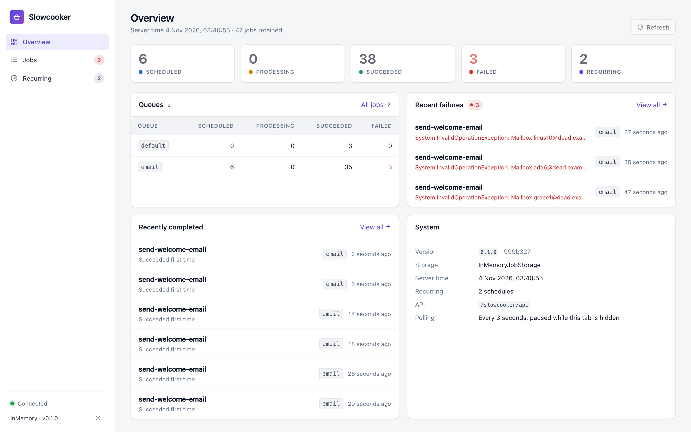
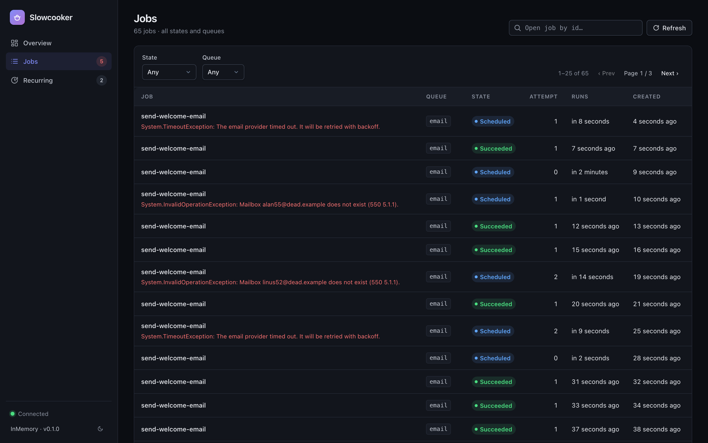

<p align="center">
  
</p>

<h1 align="center">Slowcooker</h1>

<p align="center">
  Background jobs for .NET that are <strong>data, not lambdas</strong>.<br>
  Typed jobs, reliable workers, cron schedules and a bundled dashboard, on Postgres, Redis or in memory.
</p>

<p align="center">
  <a href="https://github.com/krnblds/Slowcooker/actions/workflows/ci.yml"></a>
  <a href="https://www.nuget.org/packages/Slowcooker"></a>
  
  <a href="LICENSE"></a>
</p>

```csharp
[JobName("send-welcome-email")]
public sealed record SendWelcomeEmail(string To, string Name) : IJob
{
    public string IdempotencyKey => $"welcome:{To}";   // enqueue twice, run once
}

public sealed class SendWelcomeEmailHandler(IMailer mailer) : IJobHandler<SendWelcomeEmail>
{
    public Task HandleAsync(SendWelcomeEmail job, JobContext ctx)
        => mailer.SendAsync(job.To, $"Welcome, {job.Name}!", ctx.CancellationToken);
}

await jobs.EnqueueAsync(new SendWelcomeEmail("ada@example.com", "Ada"));
```

<p align="center">
  <picture>
    <source media="(prefers-color-scheme: dark)" srcset="docs/assets/dashboard-dark.png">
    
  </picture>
</p>

## Highlights

- **Jobs are records.** A job is a small immutable message with a stable `[JobName]`. Rename classes, move namespaces, change method signatures: nothing in the queue breaks.
- **Handlers come from DI.** `IJobHandler<TJob>` is resolved from a fresh scope per job. Constructor-inject whatever you need; no activator abstraction.
- **Built for failure.** Leases with heartbeats instead of invisibility timeouts, attempts counted at fetch time so a crashing job cannot loop forever, exponential backoff with dead-lettering, graceful shutdown that requeues without burning an attempt, idempotency keys on the job itself.
- **Cron that reads like English.** `Cron.Daily.At(6)`, `Cron.Weekdays.At(18)`, `Cron.Monthly.OnLastDay().At(18, 30)`, with time zones and DST handled. Recurring jobs trigger exactly once across instances with compare-and-set, no distributed locks.
- **Async end to end.** Workers never block a thread; concurrency is a semaphore. Storage pushes wake-ups (`LISTEN/NOTIFY`, pub/sub); polling is only the fallback.
- **A dashboard in one line.** `AddAdminUserInterface()` serves a compiled Vue dashboard from inside the package: overview, jobs with filters and requeue/delete, recurring schedules with cron preview, light and dark. Local-only by default, your authorization policy in production.
- **Three storages, one contract.** PostgreSQL, Redis and in-memory providers all pass the same 40-test contract suite covering concurrent fetch, lease loss and crash recovery.

## Install

```bash
dotnet add package Slowcooker
dotnet add package Slowcooker.Storage.Postgres     # or Slowcooker.Storage.Redis / Slowcooker.Storage.InMemory
dotnet add package Slowcooker.AspNetCore           # the dashboard, optional
```

Targets .NET 10. The dashboard is compiled into `Slowcooker.AspNetCore`, so nothing but NuGet is needed to use it.

## Quick start

**1. Register it.** A storage, your handlers, a worker in processes that should run jobs, and the dashboard.

```csharp
builder.Services.AddSlowcooker()
    .UsePostgres(builder.Configuration.GetConnectionString("Postgres")!)   // or .UseRedis("localhost:6379") / .UseInMemoryStorage()
    .AddHandlersFrom(typeof(Program).Assembly)                              // or .AddHandler<SendWelcomeEmailHandler>()
    .AddWorker(o =>
    {
        o.Queues = ["email", "default"];
        o.MaxConcurrency = 8;
    })
    .AddAdminUserInterface(ui => ui.RequireAuthorization("ops"));          // /slowcooker/ and its API at /slowcooker/api
```

A web API that only *creates* jobs omits `AddWorker()`. Workers and clients can live in different processes and scale independently.

**2. Define a job and its handler.** Jobs are records; handlers are classes resolved from a fresh DI scope per job.

```csharp
[JobName("charge-card")]          // stored name; rename the record later without breaking queued jobs
[Queue("payments")]               // default queue for this type
public sealed record ChargeCard(string OrderId, decimal Amount) : IJob
{
    public string IdempotencyKey => $"charge:{OrderId}";   // a double-submit creates one job
}

public sealed class ChargeCardHandler(IPaymentGateway gateway, ILogger<ChargeCardHandler> log) : IJobHandler<ChargeCard>
{
    public async Task HandleAsync(ChargeCard job, JobContext ctx)
    {
        log.LogInformation("Charging {Order}, attempt {Attempt}", job.OrderId, ctx.Attempt);
        await gateway.ChargeAsync(job.OrderId, job.Amount, ctx.CancellationToken);
        await ctx.Jobs.EnqueueAsync(new SendReceipt(job.OrderId), cancellationToken: ctx.CancellationToken);   // chain work
    }
}
```

**3. Enqueue.** Inject `IJobClient` anywhere.

```csharp
await jobs.EnqueueAsync(new ChargeCard("o-42", 99.00m));
await jobs.ScheduleAsync(new SendReminder("o-42"), TimeSpan.FromDays(3));
await jobs.ScheduleAsync(new CloseBooks(2026, 11), new DateTimeOffset(2026, 12, 1, 0, 0, 0, TimeSpan.Zero));
await jobs.EnqueueAsync(new ChargeCard("o-43", 5m), new JobOptions { Queue = "urgent", IdempotencyKey = "custom" });
```

**4. Recurring jobs.** A `Cron` schedule with a time zone. Declare on startup; safe on every instance.

```csharp
await recurring.AddOrUpdateAsync("daily-report", new GenerateReport("eu"), Cron.Daily.At(6),
    new RecurringJobOptions { TimeZone = TimeZoneInfo.FindSystemTimeZoneById("Europe/London") });
await recurring.AddOrUpdateAsync("cleanup", new PurgeTempFiles(), Cron.Every(TimeSpan.FromMinutes(15)));
await recurring.AddOrUpdateAsync("payroll", new RunPayroll(), Cron.Monthly.OnLastDay().At(18, 30));
await recurring.TriggerAsync("daily-report");   // run it now, schedule untouched
await recurring.RemoveAsync("daily-report");
```

`Cron` is a small value type you can read: `Cron.Weekly.On(DayOfWeek.Monday, DayOfWeek.Thursday).At(9)`, `Cron.Weekdays.At(18)`, `Cron.Hourly.AtMinute(45)`, `Cron.Yearly.InMonth(12).OnDay(25)`, `Cron.Never` (pause without deleting). It converts implicitly to the expression string, and `Cron.Parse("0 3 * * sun")` takes any five-field (minute) or six-field (seconds) expression. `cron.Upcoming(now, zone, 5)` previews the next runs, and the dashboard exposes the same as `GET /cron/preview`. Daylight-saving transitions are handled by [Cronos](https://github.com/HangfireIO/Cronos).

## The dashboard

<p align="center">
  
</p>

```csharp
builder.Services.AddSlowcooker()
    .UsePostgres(connectionString)
    .AddAdminUserInterface(ui =>
    {
        ui.Path = "/jobs";                   // default /slowcooker
        ui.RequireAuthorization("ops");      // any ASP.NET Core policy; required for anything reachable from the internet
    });
```

That is the whole setup. The UI is compiled into `Slowcooker.AspNetCore` and mounted after your own middleware, so authentication and forwarded headers have already run. Without `RequireAuthorization` it answers requests from the local machine only, because the API can requeue and delete jobs. If your app has a catch-all route (a SPA fallback), call `app.MapSlowcookerAdminUserInterface()` explicitly so the dashboard takes precedence.

What it gives you:

| Page | What you can do |
|---|---|
| Overview | State counters, per-queue counts, recent failures and completions, server time and storage |
| Jobs | Filter by state and queue, page through, open a job by id, inspect payload and full error, requeue or delete. Filters live in the URL, so a view is a link you can share |
| Recurring | Every schedule with next and last run, run one now, delete, cron scratchpad with presets and time zones |

Building your own UI? `app.MapSlowcookerApi("/slowcooker")` mounts just the JSON API ([reference](docs/dashboard-api.md)), and [`dashboard/kit`](dashboard/kit/README.md) is the Vue 3 component kit the bundled UI is built from: typed client, polling composables, tables and detail views.

## Concepts

**Job.** A record implementing `IJob`. Serialized with `System.Text.Json` (enums as strings). Keep it small and self-contained: ids, not entities. The optional `IdempotencyKey` property deduplicates creation; keys are released when the job is deleted or purged.

**Handler.** `IJobHandler<TJob>`, one or many per class. Registered as scoped: constructor-inject whatever you need. Throwing fails the attempt. Jobs run **at least once**; a handler must tolerate running twice.

**JobContext.** `Id`, `Attempt` (1 on the first run), `Queue`, `CreatedAt`, `RunAt`, `LastError`, `Jobs` (a client for follow-ups) and `CancellationToken`. The token fires on shutdown or when the lease is lost; stop promptly, the job will run again elsewhere.

**Names.** A job is stored under its `[JobName]`, or its version-free CLR name when it has none. Use the attribute for anything that reaches production. Two types with the same name is a startup error.

**Queues.** Free-form strings. A worker serves the queues in `WorkerOptions.Queues`; jobs on other queues wait for a worker that serves them. Per type default via `[Queue]`, per call via `JobOptions.Queue`.

**States.** `Scheduled` (waiting, due at `RunAt`) → `Processing` (leased to a worker) → `Succeeded` or `Failed`. Retries go back to `Scheduled` with a later `RunAt`. That is the whole state machine.

**Retries.** `IRetryPolicy.GetRetryDelay(attempt, exception)` returns a delay or `null` to give up. The default `ExponentialBackoffRetryPolicy` does 10 attempts with the curve `(attempt-1)^4 + 15 + jitter` seconds (about two hours in total) and honours a `DoNotRetry` list. Exhausted jobs are `Failed`, kept for `FailedJobRetention` (7 days) and can be requeued from the dashboard.

**Leases.** Fetching a job leases it for `LeaseDuration` (5 minutes). The worker extends the lease every third of that while the job runs. If the process dies, the lease expires and another worker fetches the job with `Attempt + 1`. Attempts are counted at fetch time, so a job that crashes the process cannot loop forever.

**Shutdown.** On `SIGTERM` the worker stops fetching, waits up to `ShutdownTimeout` (20 s) for running jobs, then cancels their tokens and requeues them **without** consuming an attempt. Keep `ShutdownTimeout` below the host's `HostOptions.ShutdownTimeout`.

**Retention.** Succeeded jobs are purged after 1 day, failed after 7, every 5 minutes. Set either to `null` to keep forever.

## Worker options

| Option | Default | Meaning |
|---|---|---|
| `Queues` | `["default"]` | Queues this worker serves |
| `MaxConcurrency` | processor count | Jobs running at once in this process |
| `FetchBatchSize` | 10 | Max jobs fetched per storage round-trip (bounded by free slots) |
| `PollInterval` | 5 s | Longest wait before asking storage again; push notifications wake it earlier |
| `LeaseDuration` | 5 min | Lease length; heartbeat every third of it |
| `ShutdownTimeout` | 20 s | Grace period for running jobs on shutdown |
| `RunRecurringJobScheduler` | true | Run the cron scheduler in this worker |
| `RecurringJobPollInterval` | 15 s | How often due schedules are checked |
| `SucceededJobRetention` / `FailedJobRetention` | 1 d / 7 d | Purge thresholds (`null` = keep) |
| `PurgeInterval` | 5 min | How often retention runs |
| `WorkerId` | `machine:pid:random` | Lease owner id in storage |

`TimeProvider` is respected everywhere: register a `FakeTimeProvider` and leases, schedules and retention become deterministic in tests.

## Storage

| Provider | Fetch | Wake-up | Notes |
|---|---|---|---|
| Postgres | `UPDATE … FROM (SELECT … FOR UPDATE SKIP LOCKED) RETURNING` | `LISTEN/NOTIFY` | Schema auto-created (or apply `PostgresJobStorage.SchemaSql` yourself). Creating jobs inside a `TransactionScope` makes them visible only on commit. Recommended for production |
| Redis | Lua script over sorted sets | pub/sub | One script per operation; use a `{hash-tag}` prefix on Cluster |
| In-memory | dictionary under a lock | in-process signal | Nothing survives a restart; for tests and development |

All three pass the same contract suite (`tests/Slowcooker.Storage.ContractTests`), which includes concurrent-fetch, lease-loss and crash-recovery scenarios. Details and the schema are in [`docs/storage.md`](docs/storage.md).

## Compared with Hangfire

Hangfire serializes a *method call* captured from a lambda. Slowcooker serializes a *message*. That one change removes a whole class of production problems and makes the rest of the design simpler:

| | Hangfire | Slowcooker |
|---|---|---|
| Unit of work | `BackgroundJob.Enqueue(() => svc.Send(a, b))`: method name, parameter types and argument JSON | `jobs.EnqueueAsync(new SendEmail(a, b))`: a record with a stable name |
| Refactoring | Renaming a method or changing a parameter breaks queued jobs | Rename anything; `[JobName]` is the contract. Payloads are plain JSON records |
| Execution model | Thread-per-worker, synchronous `Task.Wait` | Async end to end; concurrency is a semaphore, not a thread pool |
| Storage round-trips per job | Several: fetch queue row, change state (with history), load parameters, update counters | One to fetch (in batches), one to settle. One row per job, no history tables |
| Waiting for work | Polling (SQL Server), long-polling in some providers | Push: Postgres `LISTEN/NOTIFY`, Redis pub/sub, in-process signal. Polling is only the fallback |
| Crash recovery | Invisibility timeout | Leases with heartbeats. A lost lease cancels the job's token; a slow worker can never overwrite the new owner's state |
| Duplicate creation | Not built in | `IdempotencyKey` on the job itself |
| Recurring jobs across servers | Distributed locks | Compare-and-set on `NextRunAt`: no locks, exactly one instance wins |
| Dashboard | Bundled UI | Bundled UI (`AddAdminUserInterface()`) on a JSON API with a safe-by-default access rule you can also use alone |
| Dependencies | Newtonsoft.Json, Owin/ASP.NET glue | `System.Text.Json`, `Microsoft.Extensions.*`, Cronos |

[`docs/design.md`](docs/design.md) explains how the failure modes of background processing are handled and tested.

## Repository

| Path | What it is |
|---|---|
| `src/Slowcooker` | Core: jobs, handlers, client, worker, recurring scheduler, retry policy |
| `src/Slowcooker.Storage.Postgres` | PostgreSQL storage (Npgsql) |
| `src/Slowcooker.Storage.Redis` | Redis storage (StackExchange.Redis), every operation a single Lua script |
| `src/Slowcooker.Storage.InMemory` | Process-local storage for tests and development |
| `src/Slowcooker.AspNetCore` | The dashboard: bundled UI (`.AddAdminUserInterface()`) and its HTTP API (`app.MapSlowcookerApi()` on its own) |
| `dashboard/kit` | Vue 3 component kit for building your own dashboard on the API. Source to copy, not an npm package |
| `dashboard/admin` | The bundled UI, built on the kit and compiled into `Slowcooker.AspNetCore` |
| `samples/Slowcooker.Samples.WebApi` | A web API with handlers, recurring jobs, demo traffic and the dashboard |
| `docs/` | [Design notes](docs/design.md), [dashboard API](docs/dashboard-api.md), [storage](docs/storage.md) |

### Running the sample and the tests

```bash
dotnet run --project samples/Slowcooker.Samples.WebApi   # in-memory storage, demo traffic, dashboard at http://localhost:5000/slowcooker/
curl -X POST localhost:5000/signups -H 'content-type: application/json' -d '{"email":"ada@example.com","name":"Ada"}'
curl localhost:5000/slowcooker/api/stats

docker compose up -d                                     # Postgres + Redis, then:
dotnet run --project samples/Slowcooker.Samples.WebApi -- --Slowcooker:Storage=Postgres
```

The first build of `Slowcooker.AspNetCore` runs `npm ci && npm run build` in `dashboard/` when Node is installed and embeds the result in the assembly (skip with `-p:SkipDashboardBuild=true`; rerun `npm run build` after changing the dashboard). Consumers of the package never need Node. In Development the sample also generates demo traffic; turn that off with `--Slowcooker:DemoTraffic=false`.

```bash
dotnet test --solution Slowcooker.sln                  # needs Docker: the Postgres and Redis suites start containers via Testcontainers
SLOWCOOKER_TEST_POSTGRES='Host=…' dotnet test …        # or point them at servers you already have
SLOWCOOKER_TEST_REDIS='localhost:6379' dotnet test …
cd dashboard && npm test                               # the component kit
```

## Status and roadmap

0.1: everything described here is implemented and covered by tests; the public API may still change before 1.0. Planned next: batches and continuations with dependencies, per-job retry attributes, OpenTelemetry metrics and traces, rate limiting and mutexes per job type.

Contributions are welcome; see [CONTRIBUTING.md](CONTRIBUTING.md). Releases are cut from version tags and published to NuGet by CI.

## License

[MIT](LICENSE).
